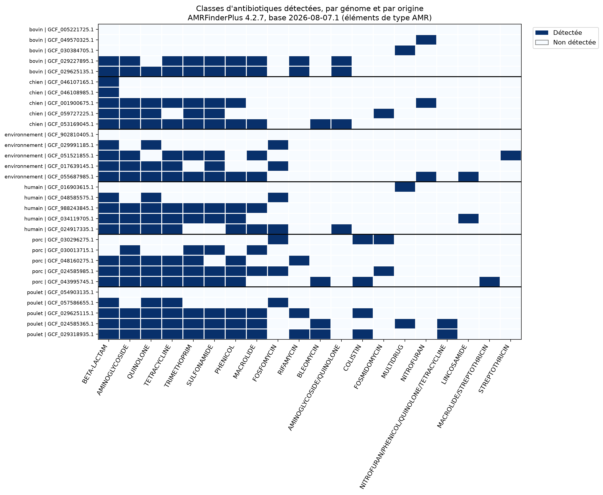

# Antibiotic resistance genes in 30 public *E. coli* genomes

A bioinformatics mini-project: which antibiotic resistance genes do public *Escherichia coli* genomes carry, and how do the profiles differ between strains?

Thirty complete genomes (5 per origin: human, pig, chicken, cattle, dog, environment) were drawn at random from NCBI RefSeq, analyzed with AMRFinderPlus, typed by MLST, and their resistance genes were located on the chromosome or on plasmids.

**Full report: [REPORT.md](REPORT.md)**

## Main findings

- The number of AMR detections ranges from 0 to 30 per genome, and it varies as much within an origin as between origins.
- Two thirds of the acquired resistance genes are on plasmids (191 of 287) and one third on the chromosome (96), often in blocks of a few tens of kb.
- 22 genomes receive an MLST type (18 distinct types); 8 genomes have no type.
- Limits: the results are genotypes, not measured resistance; 5 genomes per origin allow no statistical test; the panel is not representative of the species. See the report for the full list.



## Repository content

| Folder | Content |
| --- | --- |
| `scripts/` | all the scripts (Python and one shell script), listed in order of use below |
| `data/` | `panel30.tsv` (the 30 genomes with origin, country and date), `panel30_accessions.txt` (accessions to download the sequences), `ecoli_metadata.tsv` and `ecoli_metadata_cat.tsv` (cleaned metadata of the 5,459 genomes, without and with the origin category) |
| `results/` | summary tables and figures; `panel30/` holds the AMRFinderPlus output of each genome; `panel_test/` holds the method test on reference strains (K-12 MG1655 is `results/K12_amrfinder.tsv`) |

Not included: the genome sequences (a 46 MB archive, to download again with the accession list), the raw metadata file of the 5,459 genomes, and the conda environments.

## Tools and versions

| Tool | Version | Role |
| --- | --- | --- |
| AMRFinderPlus | 4.2.7, database 2026-08-07.1 | resistance genes and mutations |
| mlst | 2.35.0 | MLST typing |
| NCBI datasets | 18.38.0 | metadata and genome download |
| Biopython | 1.88 | reading FASTA files |
| pandas | 3.0.6 | summary tables |
| conda (Miniforge) | 26.7.2 | environments |

## Reproducing the analysis

Conda environments (channels: conda-forge, then bioconda):

```bash
conda config --append channels bioconda
conda create -n amr_env ncbi-amrfinderplus
conda activate amr_env && amrfinder -u     # downloads the database (here: 2026-08-07.1)
conda create -n analyse pandas matplotlib biopython
conda install -n analyse ncbi-datasets-cli
conda create -n typage mlst
```

**1. Metadata and panel** (environment `analyse`)

```bash
datasets summary genome taxon "Escherichia coli" --assembly-level complete --assembly-source RefSeq --exclude-atypical --mag exclude --as-json-lines > ecoli_complete_refseq.jsonl
python scripts/filtrer_metadonnees.py      # -> ecoli_metadata.tsv
python scripts/categoriser_origines.py     # -> ecoli_metadata_cat.tsv
python scripts/tirer_panel.py              # -> panel30.tsv and panel30_accessions.txt (random_state = 42)
```

**2. Download and integrity check**

```bash
datasets download genome accession --inputfile panel30_accessions.txt --include genome --filename panel30.zip
unzip -q panel30.zip && md5sum -c md5sum.txt
```

**3. AMRFinderPlus** (environment `amr_env`; the script skips genomes already done)

```bash
bash scripts/lancer_amrfinder_panel30.sh
```

**4. MLST typing** (environment `typage`)

```bash
mlst --scheme ecoli ncbi_dataset/data/GCF_*/*_genomic.fna > panel30_mlst.tsv
```

**5. Tables and figures** (environment `analyse`), in this order

```bash
python scripts/combiner_panel30.py
python scripts/resume_panel30.py
python scripts/tableau_final_panel30.py
python scripts/contigs_panel30.py
python scripts/localisation_amr_panel30.py
python scripts/genes_par_localisation.py
python scripts/etendue_amr_chromosome.py
python scripts/positions_amr_chromosome.py
python scripts/heatmap_panel30.py
```

`combiner_panel30.py` and `resume_panel30.py` both write `panel30_resume_par_genome.tsv`; the second one gives the final counts (AMR-type elements only).

**Other scripts.** `combiner_resultats.py`, `resume_classes.py` and `figure_heatmap.py` produce the table and figure of the five-genome method test. `attributs_biosample.py`, `voir_sources.py` and `table_origines.py` were used to explore the metadata.

## Notes

- **Paths are hard-coded** (`/mnt/c/Bioinfo_RAM/...`) at the top of each script. Edit them to match your own folders before running.
- Comments and some variable names in the scripts are in French.
- NCBI content changes over time: running the metadata step again later may give a different list of genomes. The panel actually used is stored in `data/panel30.tsv`.
- The MLST scheme selected by `--scheme ecoli` uses 8 loci (uidA, trpB, trpA, icdA, pabB, putP, polB, dinB), which correspond, judging by their names, to the Institut Pasteur scheme.

## AI assistance

The Python scripts used in this project were written with the help of an AI assistant (Claude, by Anthropic).
